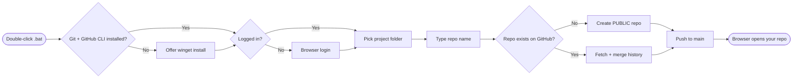

<div align="center">


[](https://github.com/ArulAgnes/GitHub-OneClick-Push-Toolkit)

<br>


</div>

---

## 🚀 What is this?

A small **one-click toolkit for Windows** that takes any project folder and puts it on your GitHub profile.
Double-click a `.bat` file, sign in through the browser, pick your folder, type a repository name — **done**.

Built for people who don't want to remember `git init`, `git add`, `git commit`, `git remote`, `git push`
— and perfect for **uploading a project from a friend's laptop** to your own GitHub account.

---

## ✨ Features

<table>
<tr>
<td width="50%">

### 🔐 Smart Login
Browser-based `gh auth login`, only when needed. Already signed in? It skips straight ahead.

### 📂 Folder Picker
A normal Windows folder window opens — choose your project, no paths to type.

### 🆕 Create + Push
Creates a **public** repository and pushes your whole project to `main`.

</td>
<td width="50%">

### 🔀 Safe Merge Mode
Repo already exists? It fetches, merges the GitHub history with yours and pushes. **No force push, ever.**

### 🛡️ Secret Guard
Warns before uploading `.env`, `.pem`, `.key`, `id_rsa` files. Your `.gitignore` is respected.

### 🧹 Friend-Laptop Friendly
Git identity is set **per project only**, and a one-click **logout** removes your access afterwards.

</td>
</tr>
</table>

---

## 🧩 How it works



---

## 📦 What's inside

| File | Purpose |
|---|---|
| 🟢 `00-FULL-Automatic-Login-Create-Push.bat` | **Everything in one run** — login → folder → repo name → create or merge → push |
| 🔑 `01-Login-to-My-GitHub.bat` | Login only (browser) |
| 🆕 `02-Create-New-Public-Repository.bat` | Create a **new public** repo and push the project |
| 🔀 `03-Push-Existing-Repository-Merge.bat` | Merge with an **existing** repo and push safely |
| 🚪 `04-Logout-From-GitHub.bat` | Log out — use this on someone else's PC |
| 📘 `README-STEP-BY-STEP.txt` | Plain-text teaching guide |

> Every `.bat` launches the `.ps1` with the same name. **Keep each pair in the same folder.**

<details>
<summary><b>📁 Project structure</b></summary>

```text
GitHub-OneClick-Push-Toolkit/
├── 00-FULL-Automatic-Login-Create-Push.bat / .ps1
├── 01-Login-to-My-GitHub.bat / .ps1
├── 02-Create-New-Public-Repository.bat / .ps1
├── 03-Push-Existing-Repository-Merge.bat / .ps1
├── 04-Logout-From-GitHub.bat / .ps1
├── README-STEP-BY-STEP.txt
└── README.md
```

</details>

---

## ⚡ Quick Start

**1️⃣ Get the toolkit**

```bash
git clone https://github.com/ArulAgnes/GitHub-OneClick-Push-Toolkit.git
```

or click **Code → Download ZIP** and extract it (don't run files from inside the ZIP).

**2️⃣ Run the one-click file**

```text
Double-click  00-FULL-Automatic-Login-Create-Push.bat
```

**3️⃣ Follow the window**

1. Copy the one-time code → press Enter → paste in the browser → **Authorize**
2. Select your project folder
3. Type the repository name
4. Your repo opens in the browser 🎉

---

## 🎓 Step-by-step mode (for teaching)

| Step | Run | Result |
|:---:|---|---|
| **1** | `01-Login-to-My-GitHub.bat` | Signed in to GitHub |
| **2** | `02-Create-New-Public-Repository.bat` | New public repo created and pushed |
| **3** | `03-Push-Existing-Repository-Merge.bat` | Existing repo merged and pushed |
| **4** | `04-Logout-From-GitHub.bat` | Laptop no longer has access to your account |

---

## 📋 Requirements

| Requirement | Link |
|---|---|
| Windows 10 / 11 with PowerShell 5.1 | Built in |
| Git for Windows | [git-scm.com/download/win](https://git-scm.com/download/win) |
| GitHub CLI | [cli.github.com](https://cli.github.com/) |

> 💡 If Git or GitHub CLI is missing, the script offers to install them with `winget`. After installing, close the window and run the BAT again.

---

## 🔒 Safety notes

- 🌍 **New repositories are public** — everyone can see the committed files. Check your project first.
- 🛑 `.env`, `.pem`, `.key`, `.pfx`, `.p12`, `id_rsa`, `id_ed25519` files trigger a warning; you must type `YES` to continue.
- 🙈 Put `node_modules`, build folders and secrets in `.gitignore` — it is always respected.
- 🚫 The scripts **never force-push** and never delete your files.
- ⚠️ On a conflict the merge is cancelled safely and the conflicting files are listed.
- 🚪 On a shared or friend's laptop, always run `04-Logout-From-GitHub.bat` when finished.

<details>
<summary><b>🛠️ Troubleshooting</b></summary>

| Problem | Fix |
|---|---|
| `Name already exists` | Use `03-Push-Existing-Repository-Merge.bat` or choose another name |
| `Repository not found` | Check the spelling and that you are logged in to the right account |
| Merge conflict | Same file changed on GitHub and locally — fix it, then run step 3 again |
| Window closes instantly | Extract the ZIP first, keep `.bat` and `.ps1` together |
| Wrong account | Run `04-Logout`, then `01-Login` |
| Want it private | GitHub → repo → **Settings → Danger Zone → Change visibility** |

</details>

---

## 🛠️ Tech Stack


---

## 🌐 More from me

<div align="center">

[](https://arul-portfolio-taupe.vercel.app/)
[](https://www.linkedin.com/in/arul-agnes-668637269)
[](https://github.com/ArulAgnes)

⭐ **If this saved you time, star the repo!** ⭐


</div>
